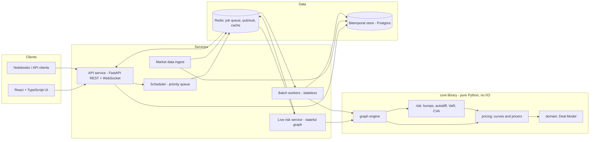
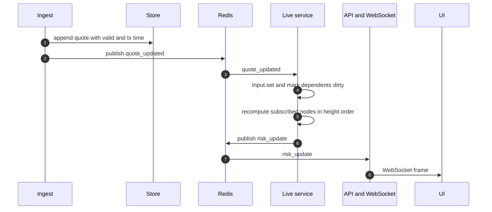
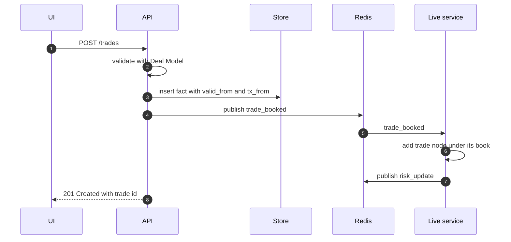
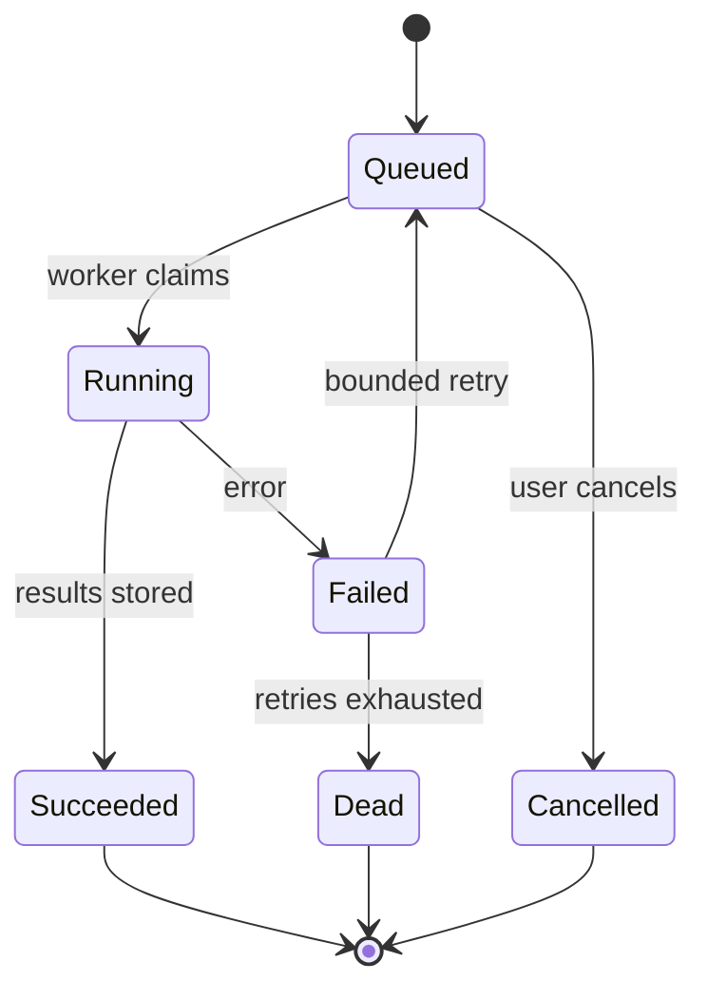
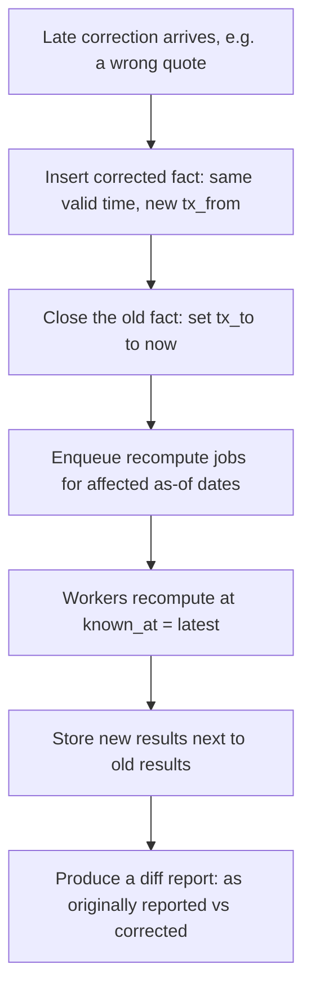
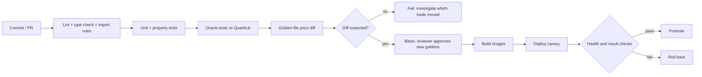

# Architecture & Workflow — Mini-Athena

> [!abstract] Purpose A buildable design for a small platform that reproduces Athena's core ideas: a **deal model**, a **bitemporal store**, an **incremental dependency graph**, a **pricing library**, a **risk layer**, a **scheduler**, and a **streaming API + UI**. This note covers _what the pieces are_, _how data and jobs flow_, and _how you build and ship it_. It contains no durations or schedules. See [[Roadmap - Build a Mini-Athena]] for learning order.

> [!note] Rendering Diagrams use Mermaid, which Obsidian renders natively. ASCII is used for the repo tree and layering rules.

---

## 1. Design principles

1. **Functional core, imperative shell.** All finance and graph logic lives in a pure library (`core/`) with no network, database or clock access. Services wrap it.
2. **Two execution modes, one engine.** A _live_ mode (long-lived, stateful graph, push updates) and a _batch_ mode (stateless workers building a graph for a given as-of context). Both use the same `core/`.
3. **Everything is reproducible.** A result is identified by _code version + inputs + valid time + known time_.
4. **Oracles before optimization.** Every pricer is validated against an independent implementation (QuantLib) before it's trusted or tuned.
5. **Vertical slice before depth.** Get one instrument through every layer, then widen.

---

## 2. System architecture



**Reading the diagram:** services fetch data from the store, hand plain objects to `core/`, and persist what comes back. `core/` never touches Postgres or Redis directly.

### 2.1 Dependency rules

```
  ui  ─►  services (api, live, scheduler, worker)  ─►  adapters (store, queue, providers)
                          │                                   │
                          └──────────────►  core  ◄───────────┘
                                   (domain ◄ pricing ◄ risk, graph)

  RULES
  • core imports nothing from services/ or adapters/
  • adapters implement ports (Protocols) that core defines
  • services compose core + adapters; they hold no finance logic
  • enforce with an import-linter rule in CI
```

### 2.2 Component specification

|Component|Responsibility|Interface|Tech|Verified by|
|---|---|---|---|---|
|`core/domain`|Deal Model: instruments, books, curves definitions, conventions|Typed dataclasses, validation|Python dataclasses/pydantic|Property tests on invariants|
|`core/pricing`|Curve bootstrapping, pricers per instrument|`price(deal, market) -> Money`|NumPy|**Oracle tests vs QuantLib**|
|`core/graph`|Nodes, inputs, contexts/overlays, invalidation, subscriptions|`get(node, ctx)`, `subscribe(node, cb)`|Pure Python|Recompute-count tests, equivalence to full recompute|
|`core/risk`|Greeks (bump, autodiff), VaR, exposure/CVA|`risk(book, measure, ctx)`|NumPy + JAX|Bump-vs-autodiff agreement, back-tests|
|`adapters/store`|Bitemporal reads/writes|`get(kind, key, valid_at, known_at)`|Postgres|Time-travel tests|
|`adapters/queue`|Priority job queue, pub/sub|`enqueue`, `claim`, `publish`|Redis|Failure/retry tests|
|`adapters/providers`|Market data loaders|`fetch(symbols, range)`|FRED/ECB loaders|Contract tests with recorded fixtures|
|`services/api`|REST + WebSocket facade|OpenAPI|FastAPI|API contract tests|
|`services/live`|Hosts the long-lived graph for the live book, pushes updates|Pub/sub messages|Python process|Tick-to-UI latency measurement|
|`services/scheduler`|Accepts jobs, assigns priority, tracks state|Job API|Python + Redis|State-machine tests|
|`services/worker`|Executes batch risk jobs|Pull from queue|Multiprocessing, later Ray|Load tests|
|`ui/`|Risk ladder, P&L explain, trade blotter|WebSocket + REST|React + TypeScript|Component + e2e tests|
|`infra/`|Containers, manifests, CI|—|Docker, kind/minikube, CI runner|Deploy smoke tests|

---

## 3. Core designs

### 3.1 Graph engine

**Concepts**

- **Input node:** a leaf holding a value (a quote, a trade term).
- **Derived node:** a pure function of its dependencies, memoized.
- **Context:** an overlay that overrides some inputs _without mutating the base graph_. Scenarios and bumps are contexts.
- **Memo key:** `(node_key, context_id)`. The same node can hold a different value per context.
- **Modes:** _pull_ (lazy evaluation on demand) and _push_ (subscribed nodes recomputed and notified after a change).

**Propagation rules**

1. Setting an input marks transitive dependents dirty. Nothing else recomputes.
2. Push recomputation runs in **height order** (topological), so each node recomputes at most once per change batch (no glitches).
3. **Early cutoff:** if a recomputed value equals the old one, its dependents are not recomputed.
4. **Batching:** ticks arriving close together are coalesced into one propagation.

```
 Quote(OIS 5Y) ─► Curve(USD OIS) ─► SwapPV(trade 17) ─► BookPV(RATES-1) ─► P&L explain
                        │
                        └──────────► SwapPV(trade 23) ─┘
 Context "bump +1bp OIS 5Y" overrides the quote only; every node above gets a *separate* value for that context.
```

**Interface sketch** (illustrative, not a final API):

```python
class Graph:
    def input(self, key, value): ...
    def node(self, key, fn, deps): ...
    def get(self, node, ctx=None): ...
    def subscribe(self, node, callback): ...

class Context:
    def __init__(self, parent=None, overrides=None): ...
    def bump(self, input_key, delta) -> "Context": ...   # returns a new context
```

### 3.2 Bitemporal store

```sql
CREATE TABLE facts (
  id         BIGSERIAL PRIMARY KEY,
  kind       TEXT        NOT NULL,                -- 'trade' | 'quote' | 'curve_def' ...
  key        TEXT        NOT NULL,
  payload    JSONB       NOT NULL,
  valid_from TIMESTAMPTZ NOT NULL,
  valid_to   TIMESTAMPTZ NOT NULL DEFAULT 'infinity',
  tx_from    TIMESTAMPTZ NOT NULL DEFAULT now(),
  tx_to      TIMESTAMPTZ NOT NULL DEFAULT 'infinity'
);
CREATE INDEX ON facts (kind, key, valid_from, tx_from);

-- Visible at (valid_at, known_at):
--   WHERE kind = $1 AND key = $2
--     AND valid_from <= $valid_at AND $valid_at < valid_to
--     AND tx_from   <= $known_at AND $known_at < tx_to
```

**Write rules**

- Facts are **never updated in place**. A correction inserts a new row and closes the old row's `tx_to`.
- `valid_*` describes when the fact is true in the world; `tx_*` describes when the system believed it.

### 3.3 Results and reproducibility

Every stored result carries enough to be re-derived:

```json
{
  "job_id": "…",
  "measure": "delta",
  "book": "RATES-1",
  "valid_at": "2026-11-17",
  "known_at": "2026-11-17T21:00:00Z",
  "code_version": "git:<sha>",
  "inputs_hash": "sha256:…",
  "value": "…"
}
```

Same `(code_version, inputs_hash, valid_at, known_at)` ⇒ same result. This is also your cache key.

### 3.4 Live mode vs batch mode

||**Live service**|**Batch worker**|
|---|---|---|
|State|Long-lived graph, in memory|Builds a graph per job|
|Trigger|Market data events|Job from the queue|
|Output|Push updates over pub/sub|Results written to store|
|Context|`known_at = latest`|Any `(valid_at, known_at)`|
|Typical use|Desk ladder, intraday P&L|End-of-day risk, VaR, restatements, CVA|

---

## 4. API & messaging contracts

|Endpoint / channel|Purpose|
|---|---|
|`POST /trades`|Book a trade (writes a fact)|
|`GET /trades/{id}?valid_at=&known_at=`|Time-travel read|
|`POST /market-data/quotes`|Append quotes|
|`GET /pricing/{trade_id}?valid_at=&known_at=`|Price a single trade|
|`GET /risk/books/{book}?measures=&valid_at=&known_at=`|Portfolio risk|
|`POST /jobs` / `GET /jobs/{id}`|Submit and track a batch risk job|
|`WS /stream/risk?book=`|Live ladder and P&L frames|
|Redis `quote_updated`|Ingest → live service|
|Redis `risk_update`|Live service → API → UI|

---

## 5. Workflows

### 5.1 Live tick → streaming risk



### 5.2 Booking a trade



### 5.3 Batch risk job lifecycle



**Rules:** jobs are **idempotent** (keyed by the cache key in §3.3), claims use a visibility timeout so a crashed worker's job returns to the queue, and priority is explicit (live-adjacent and interactive jobs outrank bulk batch).

### 5.4 Correction & restatement (bitemporal)



### 5.5 Engineering workflow (CI/CD with a "bless" gate)



---

## 6. Build workflow (how to actually make it)

### 6.1 Order of construction

1. **Walking skeleton.** One instrument (FX forward) through every layer: domain object → pricer → graph node → store row → API endpoint → UI number, all gated by CI. Nothing is deep yet; everything is connected.
2. **Widen.** Add instruments one at a time (swap, option). Each addition ships with its oracle test.
3. **Deepen, layer by layer.** Graph features (contexts, push, early cutoff) → bitemporal reads → risk measures → scheduler and workers → containers and cluster.
4. **Harden.** Load tests, failure injection (kill a worker mid-job, drop a Redis message), reproducibility checks.

### 6.2 Per-feature loop

```
 write a failing oracle/property test
        ▼
 implement in core/ (pure)  ──►  wire through adapters/services
        ▼
 golden-file update (blessed)  ──►  benchmark the hot path
        ▼
 record the decision in docs/adr/  ──►  merge
```

### 6.3 Definition of done (any feature)

- [ ] Tests: unit, property, and oracle where applicable
- [ ] Deterministic: same inputs, same output
- [ ] Observable: metrics and structured logs added
- [ ] Documented: README or ADR updated
- [ ] No new import-rule violations

---

## 7. Repo layout

```
mini-athena/
├─ core/                   # pure library: no network, no DB, no clock
│  ├─ domain/              # Deal Model
│  ├─ pricing/             # curves, pricers
│  ├─ graph/               # nodes, contexts, propagation
│  └─ risk/                # bumps, autodiff, VaR, CVA
├─ adapters/
│  ├─ store/               # bitemporal repository (Postgres)
│  ├─ queue/               # Redis queue + pub/sub
│  └─ providers/           # FRED / ECB loaders
├─ services/
│  ├─ api/                 # FastAPI REST + WebSocket
│  ├─ live/                # stateful graph host
│  ├─ scheduler/
│  └─ worker/
├─ ui/                     # React + TypeScript
├─ infra/                  # Dockerfiles, k8s manifests, CI config
├─ tests/
│  ├─ oracle/              # vs QuantLib
│  ├─ golden/              # blessed price snapshots
│  ├─ property/            # Hypothesis
│  └─ integration/
└─ docs/
   └─ adr/                 # architecture decision records
```

---

## 8. Non-functional requirements

|Requirement|Mechanism|How you verify it|
|---|---|---|
|Correctness|Oracle tests, property tests, golden files|CI gate|
|Determinism|Fixed seeds, pure core, no wall-clock in `core/`|Run twice, compare hashes|
|Incremental efficiency|Dirty-flag propagation, early cutoff|Recompute counters vs full recompute|
|Latency|Tick coalescing, in-memory live graph|Measure tick-to-UI p50/p99, **set targets after a baseline**|
|Throughput|Parallel workers, priorities|Load test with scaling curve|
|Auditability|Bitemporal facts, result provenance|Time-travel reproduction test|
|Resilience|Idempotent jobs, visibility timeouts, bounded retries|Kill-a-worker test|
|Observability|Prometheus metrics, structured logs, optional tracing|Dashboards with queue depth, job latency, recompute counts|

---

## 9. Technology choices & alternatives

|Concern|Choice|Alternatives|
|---|---|---|
|Core language|Python (hot kernels later in Numba/C++/Rust)|Pure C++/Rust core|
|Numerics / autodiff|NumPy + JAX|PyTorch|
|Store|Postgres (bitemporal schema above)|SQLite for local dev; XTDB|
|Queue / pub-sub|Redis|Celery, Ray, NATS (Kafka is overkill here)|
|Parallelism|`multiprocessing`, then Ray|Dask|
|API|FastAPI + WebSockets|Any ASGI framework|
|UI|React + TypeScript|—|
|Packaging / deploy|Docker, kind or minikube|Docker Compose first|
|Testing|pytest, Hypothesis, QuantLib oracle|—|
|Observability|Prometheus + Grafana|OpenTelemetry|

---

## 10. Mapping to the real Athena

|Mini-Athena|Athena counterpart|Confidence|
|---|---|---|
|`core/domain`|Deal Model|🟢 named publicly|
|Bitemporal store|Hydra (globally replicated object DB)|🟢 Hydra; 🟡/⚪ bitemporal detail not confirmed|
|`core/graph` pull mode|Pixie (DAG)|🟢|
|`core/graph` push mode + live service|Reactive Athena|🟢|
|Scheduler + workers|Job scheduling, Risk Scheduler, compute grid|🟢|
|API + UI|Athena Web, Qt apps, Risk-as-a-Service surfaces|🟢|
|CI "bless" gate + canary|Bless step, layered runtime, binary train|🟢|
|Version-pinned results|Versioned code in Hydra, audit and traceability goals|🟢/⚪|

> [!warning] What this is not Athena's internals aren't public beyond the sources in [[Athena - JPMorgan Trading and Risk Platform]]. This design reproduces the **ideas**, not the implementation.

---

## 11. Decision log (start these as ADRs)

|ID|Decision|Alternatives considered|Revisit when|
|---|---|---|---|
|ADR-001|Pure `core/` with ports/adapters|Monolithic app|Import rules become painful|
|ADR-002|Live and batch modes share one engine|Separate engines|Live latency can't be met|
|ADR-003|Bitemporal facts table in Postgres|XTDB, event sourcing|Query patterns outgrow indexes|
|ADR-004|Redis for queue and pub/sub|Celery, Ray, NATS|Need stronger delivery guarantees|
|ADR-005|QuantLib as test oracle only|Depend on QuantLib|Reimplementing becomes pointless|
|ADR-006|Results keyed by code version + inputs|Latest-only results|Storage cost dominates|

## 12. Open questions to resolve while building

- Context identity: hash of overrides vs structural sharing?
- How much of the live graph can be rebuilt on restart vs persisted?
- Do bumps run as separate contexts in one process, or fan out to workers?
- Where is the line between "market state" (shared) and "scenario state" (per job)?

---

## Vault Connections

This source-derived note is connected to [[Athena]], [[Athena Detailed Report]], [[ADR-001 Incremental Dependency Graph]], [[ADR-002 Bitemporal Store]], [[ADR-003 Reproducible Results]], [[ADR-004 Live and Batch Engine]]. Its claims are retained as supplied; consult [[Claims, Contradictions & Uncertainty]] for cross-source caveats.
